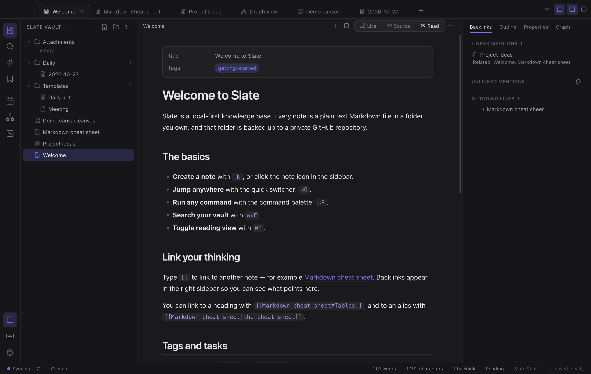
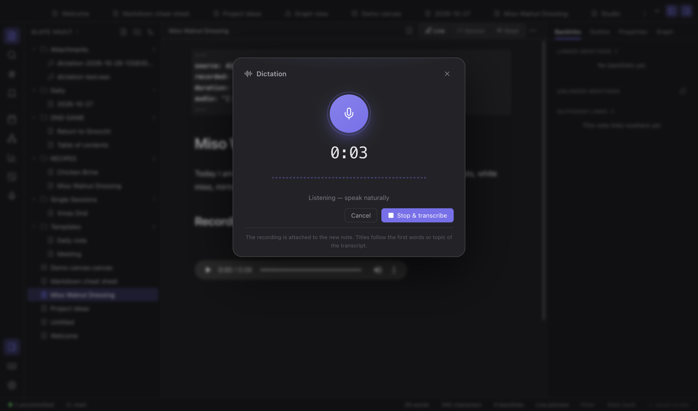
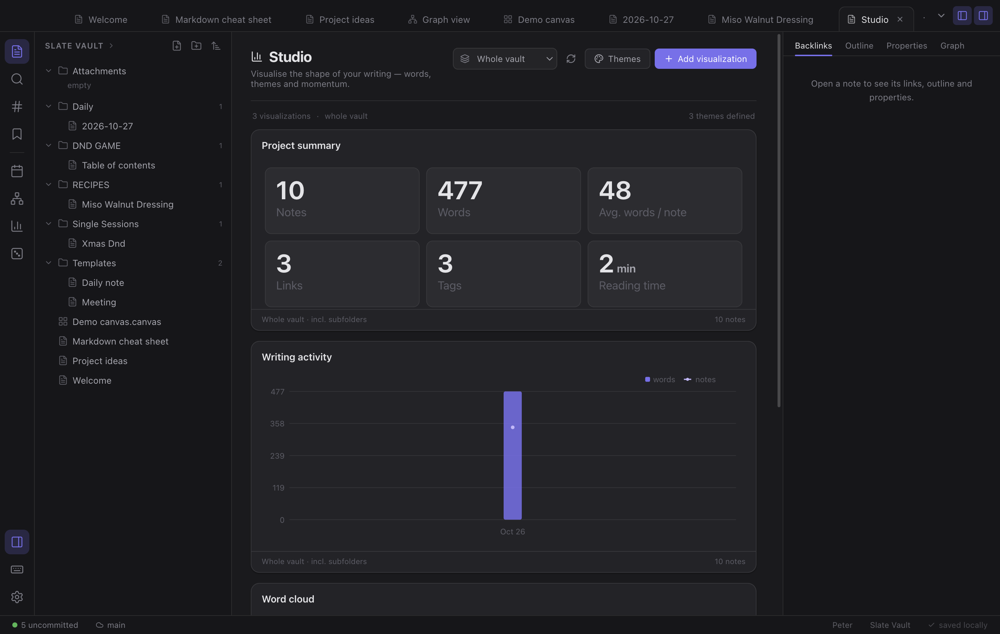
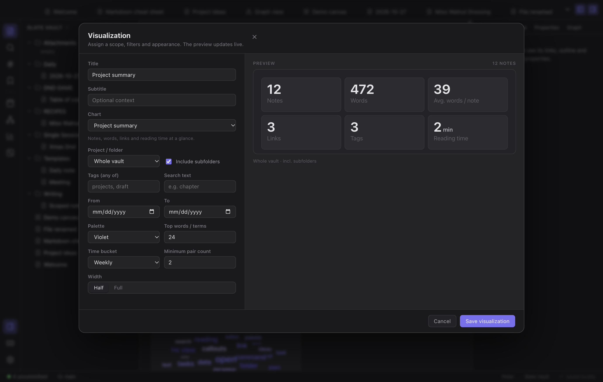
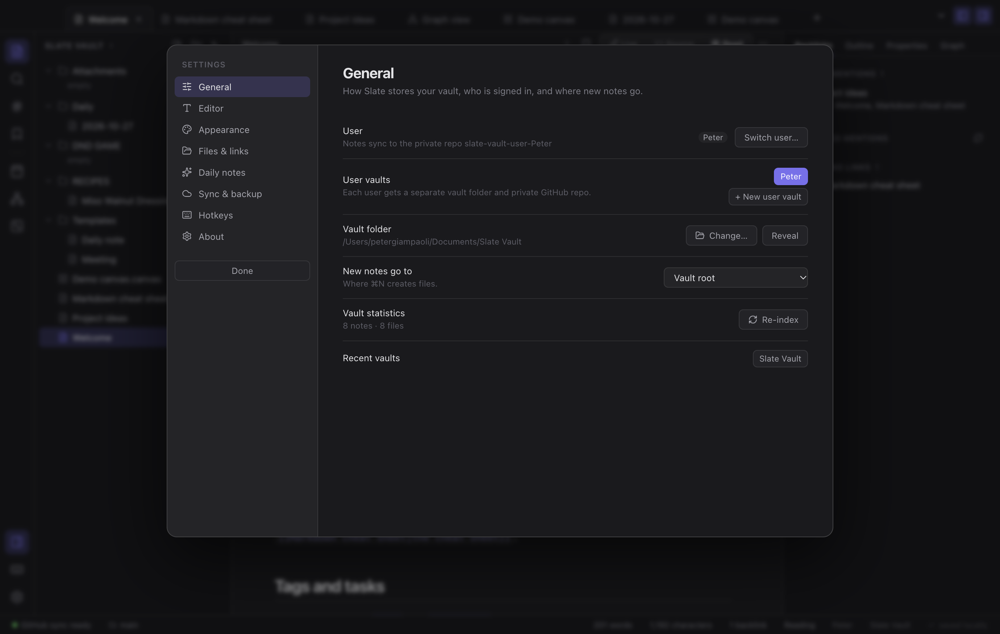

# Slate

A local-first Markdown knowledge base for macOS — an Obsidian-style vault that lives in a folder of plain text files and syncs to a **private GitHub repository** you own.



Slate does not use a proprietary database. Notes are `.md` files, canvases are `.canvas` JSON, attachments are regular files, and version history is ordinary `git` history. You can open the vault in Finder, edit files in any editor, and Slate will pick up the changes.

---

## Features

### Notes & editor
- **Every note has a title heading.** The first `# Heading` is the note's name: renaming the file rewrites the heading, and editing the heading renames the file (after a short pause). Daily notes and templates are exempt so their date/placeholder headings survive. Use **Add title headings to all notes** from the palette to normalise an existing vault.
- **New notes follow your selection.** Click a folder in the explorer and `⌘N` creates the note inside it; the folder is highlighted in the sidebar. Without a folder selected, the `New notes go to` setting applies.
- **CodeMirror 6** editor with a custom **live preview** renderer: headings, bold/italic, `==highlights==`, inline code, task checkboxes, images, wiki links, embeds, callouts and fenced code are styled inline while raw Markdown appears when your cursor is on the line.
- **Source** and **Reading** modes alongside live preview (`⌘E`).
- **Wiki links** — `[[Note]]`, `[[Note|alias]]`, `[[Note#Heading]]`, embeds `![[Note]]` — with autocomplete when you type `[[`.
- **Backlinks**, **outgoing links**, and **unlinked mentions** in the right sidebar.
- **Tags** with nested `#project/slate` support, a tag pane, and tag completion.
- **YAML frontmatter / properties** with an editable properties panel.
- **Daily notes** from a template with moment-style date tokens (`YYYY-MM-DD`, `dddd`…).
- **Templates** folder + insert-template command.
- **Code blocks** with syntax highlighting, **KaTeX math**, **Mermaid diagrams**, **GFM tables**, task lists, footnotes, and Obsidian **callouts** (`> [!tip]`).
- **Attachments**: drag & drop or paste images, resolved by filename so notes survive moves.
- **Canvas** — Obsidian-compatible `.canvas` files with text/note cards, groups, connections, drag, resize and zoom.
- **Studio** — dashboards of word clouds, word maps, theme timelines, activity and directory charts, scoped to folders with filters and per-chart settings.
- **Offline dictation** — one click records, whisper.cpp transcribes on-device, and a titled note with the audio attached is created automatically.
- **Graph view** — force-directed global graph and a local 2-hop graph, colour-coded by folder, with search and pan/zoom.

### Navigation & workspace
- Tabs, split panes, per-tab back/forward history, resizable sidebars, focus mode.
- **Quick switcher** (`⌘O`), **command palette** (`⌘P`), full-vault **search** with `tag:`, `path:`, `file:` and `/regex/` filters.
- **Outline** pane, bookmarks, starred tags, random note.
- **Reading view** with interactive task checkboxes, clickable wiki links and heading anchors.
- **Export** to PDF, HTML or Markdown; print-ready layout.
- Native macOS menu bar, traffic-light window, dark/light/system themes and eight accent colours.
- Custom CSS snippets, editor font/size/measure settings.

### Dictation



Press **⌘⇧M**, click the microphone in the sidebar, or run *Dictate a note* from the command palette. Slate records the microphone, transcribes it **offline** with whisper.cpp, then creates a note for you:

- The note is titled from what you said — recipe phrasing (“today I’m making…”), “how to make…”, discussion/theme phrasing, ingredient lists, or the first few words.
- The transcript is formatted into paragraphs, with `source: dictation`, the timestamp, duration and audio reference in the frontmatter.
- The WAV recording is attached to the note and playable in both live preview and reading view.
- If recognition fails, the recording can still be saved as an audio note — nothing is lost.
- Everything runs on this Mac. No audio leaves the machine and no API key is required.

Dictation uses the bundled **Whisper base.en** model (about 140 MB) and the whisper.cpp engine. The binaries live in `resources/whisper` and are excluded from git; run:

```bash
npm run setup:whisper
```

once before building a distributable. The packaged DMG includes them (≈256 MB).

### Studio — project visualizations



Studio turns the vault into a set of dashboards for writers and creators. Visualizations are scoped to a project folder (with or without subfolders), filtered by tag, text or date range, and saved with the vault in `.slate/studio.json` so they sync with the notes.

| Chart | What it answers |
| --- | --- |
| Project summary | How many notes, words, links and reading minutes? |
| Writing activity | How much did I write each week/month? |
| Word cloud | Which words do I lean on? |
| Word map | Which words keep appearing together? |
| Theme frequency | Which themes dominate the draft? |
| Theme timeline | When does each theme appear or disappear? |
| Tags / Folders | Where is the work concentrated? |

Each card is a mini Datawrapper-style chart: editable title and subtitle, palette, time bucket, top-N limit and width. Cards can be exported as SVG. **Themes** are keyword groups you define (or seed from your tags), with a colour and any number of phrases; the heatmap tracks them across drafts.



Open Studio from the ribbon, with `⌘P` → *Open Studio*, or right-click a folder → **Open Studio for this folder**. Three starter layouts build a dashboard in one click: *Writer's dashboard*, *Theme tracker* and *Project overview*.

### Storage & sync
- The vault is a git repository. Sync = `fetch → pull --rebase --autostash → add → commit → push`.
- **Create a private GitHub repo** from Settings (uses the `gh` CLI), or connect any existing remote.
- **Automatic sync** on an interval, optionally after every save.
- **Version history** per note: browse commits, preview any revision, restore it.
- Conflicts are **reported, never silently overwritten**. External file changes are detected with `fs.watch` and reloaded unless you have unsaved edits (then you get a conflict banner).

---

## Quick start

```bash
cd slate
npm install
npm run setup:whisper   # build the offline speech engine + model (once)
npm run dev             # development, hot reload
```

Build a distributable **.app / .dmg**:

```bash
npm run dist       # arm64 + x64
npm run dist:x64   # or a single architecture
```

Artifacts are written to `release/`. The build is unsigned (`identity: null`), which is fine for local use. If you download the DMG from elsewhere, right-click → Open the first time.

### Repositories

| Repository | Visibility | Purpose |
| --- | --- | --- |
| [petergiampaoli/slate](https://github.com/petergiampaoli/slate) | **public** | Application source |
| [petergiampaoli/slate-vault-user-Peter](https://github.com/petergiampaoli/slate-vault-user-Peter) | **private** | Peter’s notes (the default user) |

Every user gets their own **private** notes repository following the same convention:

```
slate-vault-user-<Name>
```

Slate never puts notes in the application repository. The earlier single `slate-vault` repository was archived after its history was moved to `slate-vault-user-Peter`.

### The vault

On first launch Slate creates `~/Documents/Slate Vault` with a welcome note, a Markdown cheat sheet, daily-note and meeting templates. Additional users live in `~/Documents/Slate Vaults/<Name>`. You can open any existing folder of Markdown files instead.

### Users



Slate is multi-user by design, so one Mac can host several people’s private vaults:

- The active user is shown in **Settings → General** and in the status bar.
- **Switch user…** opens that user’s vault. If the private repo exists it is cloned; if it does not, Slate creates the folder, starter notes and a private `slate-vault-user-<Name>` repository automatically.
- **+ New user vault** does the same for a brand-new name.
- Every user’s notes, git history and sync state are completely separate.
- The same actions are available from the command palette (`⌘P` → “Switch user vault”).

### Setting up sync in a new vault

1. Open **Settings → Sync & backup** (`⌘,`).
2. Press **Create private repo** — Slate runs `gh repo create slate-vault-user-<Name> --private --source . --remote origin --push`.
   Requires the GitHub CLI (`brew install gh`) and `gh auth login`.
3. Or paste an existing repository URL and press **Save**.
4. Use `⌘⇧S` or the status-bar item to sync manually.

> Prefer a different remote? Anything git can push to works: GitLab, a self-hosted server, or a bare repo on a NAS.

---

## Project structure

```
slate/
├── electron.vite.config.ts        # main / preload / renderer bundling
├── electron-builder.yml           # macOS packaging
├── build/                         # icon source + .icns
├── resources/whisper/             # whisper.cpp + base.en model (not in git)
├── scripts/setup-whisper.sh       # builds/downloads the dictation engine
├── src/
│   ├── main/
│   │   ├── index.ts               # app lifecycle, window, protocol, menus
│   │   ├── ipc.ts                 # typed IPC surface (files, git, dialogs, export)
│   │   ├── vault.ts               # vault filesystem + watcher + path safety
│   │   ├── git.ts                 # status / sync / history / repo creation
│   │   ├── store.ts               # persisted settings
│   │   └── menu.ts                # macOS application menu
│   ├── preload/index.ts           # contextBridge API (window.slate)
│   ├── shared/types.ts            # shared TypeScript contracts
│   └── renderer/src/
│       ├── App.tsx                # shell, theme, menu actions, autosync
│       ├── state/store.ts         # zustand store: vault, tabs, index, sync
│       ├── lib/
│       │   ├── indexer.ts         # link parsing, resolution, backlinks, tags
│       │   ├── markdown.ts        # unified/remark/rehype rendering pipeline
│       │   ├── search.ts          # query parser, ranked search, fuzzy switcher
│       │   └── utils.ts
│       └── components/            # editor, sidebar, graph, canvas, modals…
```

### Design notes

- **Single source of truth for links.** `indexer.ts` parses every note into `NoteMeta` (frontmatter, tags, headings, links, words) and resolves links Obsidian-style: exact path, then shortest filename match, then alias.
- **The renderer owns no files.** All disk access goes through IPC with a path-traversal guard in `vault.absolute()`.
- **Attachments use a custom `slate://` protocol** rather than `file://`, so images and PDFs load inside the sandboxed renderer without disabling web security.
- **Live preview is a decoration pass**, not a separate document: one CodeMirror state, regex-driven `Decoration.mark`/`replace`/widget ranges, recomputed only on document, selection or viewport changes.
- **Crash-safe editing**: content is written 700 ms after you stop typing, on window blur, and before sync.

---

## Keyboard shortcuts

| Action | Shortcut |
| --- | --- |
| New note | `⌘N` |
| Quick switcher | `⌘O` |
| Command palette | `⌘P` |
| Search vault | `⌘⇧F` |
| Find in note | `⌘F` |
| Toggle reading view | `⌘E` |
| Toggle source mode | `⌘⌥E` |
| Daily note | `⌘⇧D` |
| Graph view | `⌘G` |
| Studio | `⌘P` → Open Studio |
| Dictate a note | `⌘⇧M` |
| Save | `⌘S` |
| Sync now | `⌘⇧S` |
| Bold / italic | `⌘B` / `⌘I` |
| Insert wikilink | `⌘K` |
| Toggle task | `⌘↵` |
| Back / forward | `⌘[` / `⌘]` |
| Close tab | `⌘W` |
| Toggle sidebars | `⌘⌥B` / `⌘⌥R` |
| Settings | `⌘,` |

Everything is also reachable through the command palette.

---

## Obsidian parity

Implemented: file explorer, Markdown + wiki links + backlinks, tags, properties, daily notes, templates, graph/local graph, canvas, search, quick switcher, command palette, split panes/tabs, themes + custom CSS, attachments, PDF/HTML export, git-based version history and sync.

Not implemented (deliberately out of scope for this build):

- A community plugin marketplace and the Obsidian plugin API (Slate is a standalone app, not a plugin host).
- Obsidian Publish / Sync services (Slate uses git instead).
- Mobile and Windows/Linux targets.
- Vim keybindings, multi-cursor, and arbitrary nested split layouts.
- Bases/databases and the newer Obsidian “Bases” table views.

---

## License

MIT. Slate is an independent project and is not affiliated with Obsidian.
